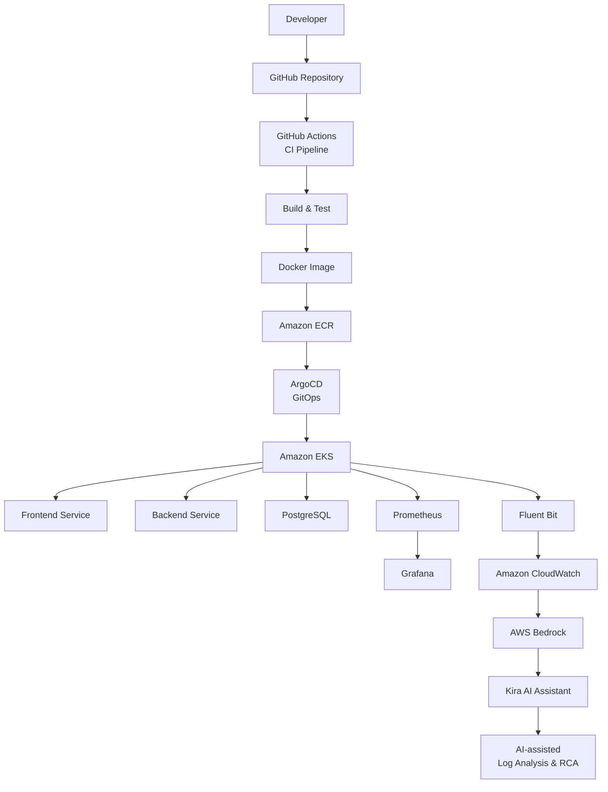

# KiraOps — Intelligent DevOps & AIOps Platform

> **Building smarter infrastructure through DevOps automation and AI-powered operations.**

KiraOps is an end-to-end cloud-native DevOps and AIOps platform that combines microservices, containerization, Kubernetes, CI/CD, GitOps, observability, and artificial intelligence.

The project explores how modern engineering teams can automate application delivery, monitor infrastructure, investigate operational issues, and use AI to improve system reliability.

## Key Features

- **Microservices Architecture:** Build and manage independent application services.
- **Containerization:** Package applications using Docker and Docker Compose.
- **Kubernetes Deployment:** Orchestrate workloads using AWS EKS.
- **Infrastructure as Code:** Provision AWS infrastructure using Terraform.
- **CI/CD Automation:** Automate build and validation workflows using GitHub Actions.
- **GitOps:** Manage Kubernetes deployments using ArgoCD and Kustomize.
- **Monitoring:** Collect and visualize metrics using Prometheus and Grafana.
- **Centralized Logging:** Forward operational logs to AWS CloudWatch using Fluent Bit.
- **AI-Powered Operations:** Integrate AWS Bedrock to support intelligent troubleshooting and operational analysis.


## Architecture Overview




## Technology Stack

| Layer | Technologies |
|---|---|
| Frontend | React |
| Backend | Node.js |
| Database | PostgreSQL |
| Containers | Docker, Docker Compose |
| Orchestration | Kubernetes, AWS EKS |
| Infrastructure | Terraform |
| Container Registry | AWS ECR |
| CI/CD | GitHub Actions |
| GitOps | ArgoCD, Kustomize |
| Monitoring | Prometheus, Grafana |
| Logging | Fluent Bit, AWS CloudWatch |
| AIOps | AWS Bedrock |
| AI Development | Claude Code, MCP Servers |

## Kira — AI Operations Assistant

Kira is the AIOps component of KiraOps, designed to bring AI-assisted intelligence into DevOps workflows.

Its intended capabilities include:

- Operational log analysis.
- Anomaly investigation.
- Incident troubleshooting.
- Root cause analysis assistance.
- Remediation recommendations.
- AI-assisted incident response.

The long-term goal is to evolve Kira into an intelligent operations assistant that can analyze operational signals, recommend actions, and support verified remediation workflows with human oversight.

## Repository Structure

```text
KiraOps/
├── .github/
│   └── workflows/
├── docs/
├── projects/
│   ├── boutique-microservices/
│   ├── Infrastructure/
│   └── aiops-assistant/
├── gitops/
│   ├── argo-cd.yml
│   ├── kustomization.yml
│   └── k8s/
├── CLAUDE.md
├── .gitignore
└── README.md
```

## Getting Started

### Prerequisites

- Git
- Docker and Docker Compose
- Node.js
- PostgreSQL
- AWS CLI
- Terraform
- kubectl
- AWS Account

### Clone the Repository

```bash
git clone https://github.com/Nitesh0717/KiraOps-AI-Intelligent-DevOps-AIOps-Platform.git

cd KiraOps-AI-Intelligent-DevOps-AIOps-Platform
```

Explore the application, infrastructure, GitOps, and AIOps directories for their respective setup and execution instructions.

**Note:** Configure the required environment variables and AWS credentials before deployment. Never commit secrets or credentials to the repository.

## Future Improvements

- Advanced anomaly detection and log correlation.
- Automated incident investigation and root cause analysis.
- AI-assisted remediation with human approval.
- SLO-based monitoring and alerting.
- Incident timelines and postmortem generation.
- Security automation and infrastructure optimization.
- Cost monitoring and resource recommendations.

*These represent planned improvements and are not necessarily implemented features.*

## Project Vision

KiraOps aims to bring DevOps automation and AI-driven operations together in a unified platform.

The goal is to move beyond traditional deployment automation toward intelligent infrastructure management, faster troubleshooting, and more reliable cloud-native systems.

## Author

**Nitesh**

- GitHub: [@Nitesh0717](https://github.com/Nitesh0717)
- Repository: [KiraOps](https://github.com/Nitesh0717/KiraOps-AI-Intelligent-DevOps-AIOps-Platform)

---

**KiraOps — Automate. Observe. Analyze. Improve.**
